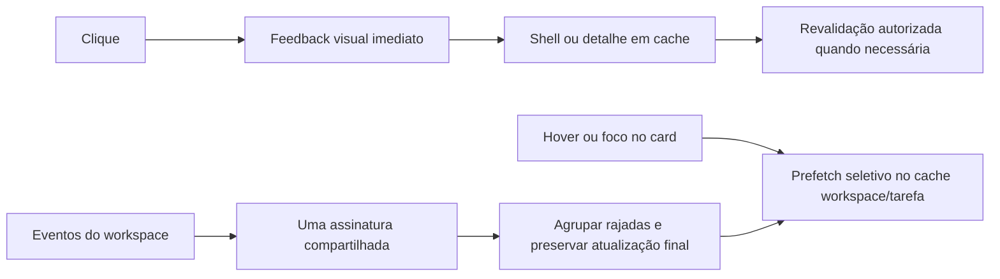

# Desempenho e resposta às interações

Auditoria e implementação: 26/09/2026. Três frentes de pesquisa: navegação, React/interações e Supabase/Postgres.

## O que significa resposta imediata

Cada interação deve produzir feedback no primeiro quadro disponível, sem esperar uma consulta remota. Quando a informação já estiver em cache, ela pode aparecer imediatamente. Em uma visita fria, o shell e um estado de carregamento acessível aparecem enquanto a informação autorizada chega. Não há promessa de latência zero na rede.

Metas de produto a medir, não resultados já demonstrados:

| Indicador | Meta |
| --- | --- |
| INP no percentil 75, por classe de dispositivo | até 200 ms |
| Feedback visual de clique | próximo frame disponível |
| Transições de entrada comuns | aproximadamente 150–220 ms, sem espera artificial |
| Troca de aba puramente local | nenhuma nova navegação RSC |
| Canais das tarefas | um por workspace e QueryClient, independentemente dos consumidores |
| Abertura de detalhe em cache | reutilizar a mesma consulta; revalidar quando necessário |

INP mede a resposta visual à interação; não mede o tempo até todos os dados da rede chegarem. Respeitar `prefers-reduced-motion` e nunca atrasar o commit de navegação para concluir uma animação.

## Evidência coletada

Estatísticas acumuladas do Postgres hospedado, consultadas somente para leitura:

| Consulta | Chamadas observadas | Tempo médio SQL | Maior tempo observado |
| --- | ---: | ---: | ---: |
| `get_task_detail` | 134 | 41,37 ms | 216,97 ms |
| overview, dois formatos | 761 no conjunto | 7,48–7,98 ms | 24,46–57,05 ms |

Esses valores não incluem rede, autenticação, renderização ou hidratação e não são percentis. Não servem como benchmark antes/depois. O banco já tem índices compostos para workspace/status/posição, workspace/faixa/posição, workspace/updated_at e projeto/cronograma. Não houve evidência para criar índices genéricos ou enfraquecer RLS.

No código havia vários consumidores de `useTasks` abrindo canais independentes; o shell baixava todos os cards apenas para mostrar duas contagens; a navegação de abas de projeto executava novamente o servidor; o contexto do workspace tinha cinco etapas sequenciais de rede. Animações do Início duravam 620 ms com atrasos adicionais, e o anel de progresso chegava a 1.400 ms incluindo espera.

## Mudanças implementadas

- `NavigationLink`: feedback local com `useLinkStatus`, pressão visual e reduced-motion. Loading boundaries adicionadas a Início, Demandas, Semana e tarefa completa. Isso fornece um fallback abaixo do layout compartilhado.
- `TaskDetailLink`: antecipa o detalhe por intenção de hover, foco ou pointerdown. Usa a mesma chave e parser de `useTaskDetail`, com validação de workspace. Não baixa os detalhes de todos os cards visíveis.
- As abas do projeto usam History API integrada ao Next, preservando URL compartilhável, sem executar novamente a página no servidor para uma mudança visual local.
- `getWorkspaceContext`: relações embutidas de memberships/workspaces e memberships/profiles reduzem cinco etapas de rede para três, mantendo verificação do usuário e RLS. O cookie de workspace não concede acesso. Contexto e catálogo de status usam deduplicação React restrita à solicitação, sem cache global de identidade.
- O Início inicia contexto, projetos e atividade em paralelo. A barra lateral usa duas consultas HEAD de contagem filtradas por workspace, responsável e período, sem baixar conteúdo dos cards nem truncar a contagem no limite de linhas da API.
- Realtime de tarefas compartilhado por QueryClient/workspace, com contagem de consumidores e limpeza ao sair. Rajadas são agrupadas em 80 ms; eventos que chegam durante um refetch garantem uma atualização posterior.
- Consultas de tarefas aceitam AbortSignal; movimentação otimista da Semana cancela uma leitura anterior antes de aplicar o preview para reduzir sobrescritas por respostas antigas.
- Entrada do Início reduzida para 180 ms sem escalonamento; anel de progresso para 220 ms. Preferência de movimento reduzido preservada.

## Limites e próximos passos de escala

1. **Paginação por contexto é a próxima mudança estrutural.** O quadro ainda lê o conjunto de tarefas do workspace. A API pode limitar respostas; apenas adicionar `limit` ocultaria cards. Introduzir contratos por projeto/status/data/responsável, cursor estável `(position,id)` ou `(updated_at,id)`, contagens separadas e UI de carregar mais. A ordenação global e o drag and drop com vizinhos ocultos precisam ser testados junto dessa mudança.
2. **Mutações:** preservar versão, rollback por entidade e resposta canônica. Alguns editores ainda aguardam refetchs antes de liberar o campo. Evoluir RPCs/DTOs para atualizar o cache com a resposta confirmada e revalidar em segundo plano; não inventar a versão seguinte nem ignorar conflitos.
3. **Payloads:** o overview calcula descrições e contagens por tarefa. Avaliar DTO mais leve, preview textual persistido e contagens transacionais somente com benchmark do volume real e custo de escrita documentado.
4. **Renderização:** agrupar tarefas por data uma vez e medir listas grandes. Virtualizar quando o perfil mostrar custo de DOM relevante, preservando teclado, leitores de tela e arraste.
5. **Realtime em escala:** avaliar Broadcast privado e eventos com origem/destino para atualizar apenas os projetos afetados. Postgres Changes verifica autorização por assinante; não remover RLS para aumentar throughput.
6. **Tela cheia do detalhe:** hoje a saída do modal usa recarga integral para escapar da rota interceptada. Uma navegação totalmente cliente precisa de uma rota canônica explícita e teste de voltar/avançar, foco e links diretos.

Não foram alterados backend, índices, políticas RLS ou permissões nesta otimização. Não foi habilitado cache compartilhado de dados autenticados nem uma migração ampla para Cache Components.

## Protocolo de validação de desempenho

- Medir em `pnpm build` + `pnpm start`, em porta livre; o prefetch automático do Next difere no desenvolvimento. Não comparar compilação fria do dev server com produção.
- Testar visita fria, retorno com cache, hover antes do clique, teclado e toque; rede normal e lenta; workspace vazio e representativo do crescimento.
- Registrar separadamente INP, tempo até shell/feedback, tempo até conteúdo, número de requests e bytes. Reportar mediana e p75/p95 com tamanho da amostra, sem inferir resultados do tempo SQL.
- Verificar RLS como usuário autenticado, troca de workspace, revogação de membership, duas sessões editando a mesma tarefa e falha de rede.
- Testes automatizados cobrem compartilhamento/limpeza do Realtime, eventos durante refetch, prefetch por intenção, isolamento por workspace, joins sob resultados vazios e contagens superiores a 1.000.
- Nesta sessão não houve benchmark interativo do navegador. Os ganhos descritos como mudanças de requests/etapas são estruturais; não são uma medição de latência percebida após a alteração.

## Fontes primárias

- [Next — Linking and Navigating](https://nextjs.org/docs/app/getting-started/linking-and-navigating)
- [Next — Prefetching](https://nextjs.org/docs/app/guides/prefetching)
- [Next — useLinkStatus](https://nextjs.org/docs/app/api-reference/functions/use-link-status)
- Guias distribuídos com Next 16.3.1 em `node_modules/next/dist/docs/`, incluindo navegação instantânea e History API.
- [Chrome — Optimize INP](https://web.dev/articles/optimize-inp)
- [TanStack — Prefetching](https://tanstack.com/query/latest/docs/framework/react/guides/prefetching)
- [TanStack — Optimistic updates](https://tanstack.com/query/latest/docs/framework/react/guides/optimistic-updates)
- [React — useDeferredValue](https://react.dev/reference/react/useDeferredValue)
- [MDN — prefers-reduced-motion](https://developer.mozilla.org/en-US/docs/Web/CSS/Reference/At-rules/@media/prefers-reduced-motion)
- [Supabase — Query optimization](https://supabase.com/docs/guides/database/query-optimization)
- [Supabase — RLS performance](https://supabase.com/docs/guides/database/postgres/row-level-security-performance)
- [Supabase — Postgres Changes](https://supabase.com/docs/guides/realtime/postgres-changes)
- [Supabase — Realtime benchmarks](https://supabase.com/docs/guides/realtime/benchmarks)

### Resultado da tentativa de medição

O usuário autorizou explicitamente a medição no navegador. O servidor local estava desligado e foi iniciado com o build de produção em `http://localhost:3001` (`pnpm start --port 3001`). A ferramenta de navegador recusou esse endereço por uma preferência salva de bloqueio, mesmo após a autorização. Nenhuma superfície alternativa foi usada para contornar essa regra. Portanto, não há números de INP ou tempos visuais medidos nesta entrega; é necessário remover a permissão salva de bloqueio no aplicativo para completar esse protocolo.
